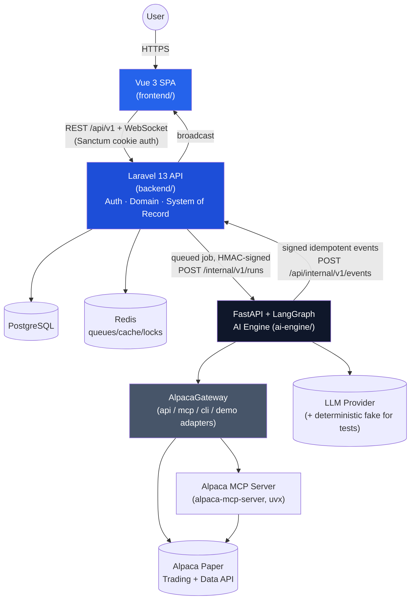

# Architecture

## Service boundaries



## Trust boundary rule

The browser talks **only** to Laravel. It never calls FastAPI, Alpaca, MCP, an
LLM provider, PostgreSQL, or Redis directly. Laravel is the system of record
for every domain table (users, settings, proposals, decisions, risk
evaluations, orders, trades, positions, snapshots, agent logs, notifications,
audit events). FastAPI owns graph orchestration and its own LangGraph
checkpoints; it reaches domain data only through the signed internal API
below, never by writing Laravel's tables directly.

## Internal API contract (Laravel <-> FastAPI)

Both directions are authenticated with an HMAC-SHA256 signature over the raw
request body plus a timestamp header, using a shared secret
(`AURA_INTERNAL_SIGNING_SECRET`, env-only, never logged). Requests older than
5 minutes (clock skew) are rejected. Every event carries a unique `event_id`;
receivers persist seen IDs and treat replays as no-ops (200, not reprocessed).

**Laravel -> FastAPI** (queued job triggers, short capability checks are sync
with a strict timeout):

| Method & path | Purpose |
|---|---|
| `POST /internal/v1/runs` | Start a graph run: `{run_id, user_id, mode, trigger, symbols[], scan_filters, risk_policy_version, alpaca_connection_id}`. Returns `{accepted, run_id}` immediately; work happens async. |
| `GET /internal/v1/runs/{run_id}` | Poll fallback if events are delayed. |
| `POST /internal/v1/runs/{run_id}/cancel` | Cooperative cancellation. |
| `POST /internal/v1/runs/{run_id}/resume` | Resume a paused (`approval_required`) run: `{decision: approved\|rejected, approved_by, notes}`. |
| `GET /internal/v1/capabilities` | Sync, <=3s timeout. Alpaca API/MCP/CLI capability snapshot for Settings/System Health. |
| `POST /internal/v1/backtests`, `GET /internal/v1/backtests/{id}` | Backtest lifecycle. |

**FastAPI -> Laravel** (signed event callbacks — the only way FastAPI affects
domain state):

`POST /api/internal/v1/events`
```json
{
  "event_id": "uuid",
  "run_id": "uuid",
  "trace_id": "uuid",
  "type": "run.started | thesis.generated | strategy.proposed | risk.evaluated | approval.requested | order.submitted | order.updated | position.updated | portfolio.updated | run.completed | run.failed | learning.recommendation",
  "payload": { "...": "typed per event type, validated against a Pydantic/Resource schema on both ends" },
  "occurred_at": "ISO-8601 UTC"
}
```
Laravel verifies signature -> timestamp -> `event_id` uniqueness -> JSON
schema for that `type`, persists into the relevant domain tables inside a
transaction, then broadcasts the corresponding frontend event over
Reverb/WebSocket. Any failure returns 4xx with a stable error code and does
**not** partially apply the event.

## Adapter/capability strategy (Alpaca)

`AlpacaGateway` (ai-engine/app/alpaca/gateway.py) exposes one internal
interface with four adapters selected by `TRADING_ENV` / discovered
capabilities:

1. **demo** — deterministic fixtures, no network call, used in `demo` mode.
2. **api** — direct `alpaca-py` SDK client against the paper base URL only.
3. **mcp** — official `alpaca-mcp-server` (PyPI package, run via `uvx
   alpaca-mcp-server`), tools discovered at startup via MCP's
   `list_tools`, never hard-coded blindly — mapped to internal capability
   names (`account_lookup`, `option_chain`, `place_option_order`, ...).
4. **cli** — safe subprocess wrapper for diagnostics only (no shell, fixed
   argv, allowlisted subcommands, timeouts), used by
   `scripts/alpaca-cli-smoke.sh` and the Settings capability matrix.

Every order/account operation records which channel handled it
(`submitted_via: alpaca_api | alpaca_mcp | alpaca_cli`) so the UI and audit
trail never imply MCP did something the direct API actually did.

## Deployment topology

Single Docker Compose stack for local dev and the hackathon demo host:
`postgres`, `redis`, `laravel` (php-fpm), `queue` (laravel queue worker),
`scheduler` (laravel schedule:work), `fastapi`, `frontend` (nginx serving the
Vite build, reverse-proxying `/api` to Laravel), optional `mcp` sidecar.
Health checks gate startup ordering (no arbitrary `sleep`s). See
`docs/deployment-aws.md` for the single-EC2-instance hackathon deployment.
