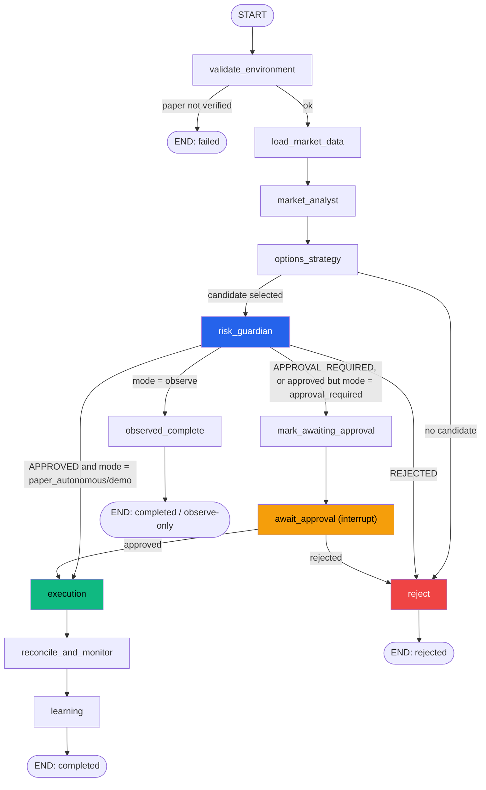

# Agent Workflow (LangGraph)

Implemented in `ai-engine/app/workflows/trading_graph.py`, state schema in
`ai-engine/app/workflows/state.py`. This is a real compiled `StateGraph`
(LangGraph 1.2.11) with conditional routing and a genuine human-approval
interrupt — verified by running it, not just diagrammed.

## Node contracts

Every node is `async def node(state: GraphState) -> dict` — a pure function
that reads the current state and returns a **partial update**, never a full
replacement, and never performs its own network calls except through the
injected `AlpacaGateway`/`LLMProvider` (both closures built once per run in
`build_graph`, so nodes stay unit-testable without patching globals).

| Node | Reads | Writes | Notes |
|---|---|---|---|
| `validate_environment` | — | `capabilities`, `meta.status` | Fails the run outright if `paper_verified` is false. |
| `load_market_data` | `universe.symbols` | `market_data`, `features` | One gateway call + deterministic feature computation per symbol. |
| `market_analyst` | `market_data`, `features` | `theses` | Confidence is a documented heuristic (see `app/agents/market_analyst.py`), not a calibrated model. |
| `options_strategy` | `theses` | `candidates`, `selected_strategy` | Real option-chain contracts only; ranks by a documented weighted score. |
| `risk_guardian` | `selected_strategy`, live account/clock via gateway | `risk_evaluation` | Delegates the actual verdict to `app/risk/engine.py` — deterministic, LLM cannot alter it. |
| `mark_awaiting_approval` | — | `meta.status = AWAITING_APPROVAL` | Exists solely so the paused status is committed to the checkpoint *before* the interrupt (see `docs/IMPLEMENTATION_STATUS.md` bug #2). |
| `await_approval` | — | `approval` | Calls `langgraph.types.interrupt(...)`; resumed via `graph.ainvoke(Command(resume={"approved": bool, "approved_by": ..., "notes": ...}), config)` with the same `thread_id` (the run's `run_id`). |
| `execution` | `selected_strategy` | `order_request`, `order_result` | Idempotent: re-checks `get_order_by_client_id` before ever calling `submit_option_order`. |
| `reconcile_and_monitor` | `order_result`, `selected_strategy` | `monitoring` | Populates real exit thresholds from `app/monitoring/exit_rules.py` (profit target / stop loss / time exit), shared with the backtest engine. |
| `learning` | (closed-trade history, supplied by the caller — empty within a single run) | `learning`, `meta.status = COMPLETED` | Never mutates risk limits directly; only ever proposes a reviewable `LearningRecommendation`. |
| `reject` / `observed_complete` | — | `meta.status`, `rejection_reason` | Terminal nodes; always explain *why*. |

## Approval / resume path

1. Laravel calls `POST /internal/v1/runs` (mode = `approval_required`).
2. The graph runs synchronously up to `risk_guardian`; if the result isn't an
   outright rejection, `mark_awaiting_approval` commits
   `status = awaiting_approval`, then `await_approval` calls `interrupt()`
   and the `ainvoke` call returns with `"__interrupt__"` in its result.
3. FastAPI's event stream has already told Laravel about `risk.evaluated`;
   Laravel shows the pending proposal on the Trade Execution page.
4. A human clicks Approve/Reject -> Laravel calls
   `POST /internal/v1/runs/{run_id}/resume` with the decision.
5. `RunManager.resume_run` re-derives the correct gateway from the
   **checkpointed** `meta.mode` (never a caller-supplied value, so a resume
   can never switch a demo run onto the real API), rebuilds the graph, and
   calls `graph.ainvoke(Command(resume=decision), config)`.
6. Execution, monitoring, and learning run exactly as in the autonomous path.

## Rejection and retry paths

- **`options_strategy` finds no candidate** (e.g. the option chain has no
  contract near the target strike): routes straight to `reject` with an
  explicit reason, never silently completes.
- **`risk_guardian` returns `REJECTED`**: every failing rule's exact
  observed value, limit, and explanation is preserved in
  `risk_evaluation.rule_results` and surfaced verbatim to the UI and the
  `run.failed` audit event — never collapsed into a generic "risk check
  failed".
- **A node raises an exception**: LangGraph's own retry/backoff can be
  layered on via `RetryPolicy` per node; this build does not currently set
  one (all nodes are fast, in-process, and side-effect-light except
  `execution`, which is idempotent by construction rather than relying on
  retries).
- **Reconciliation of an uncertain broker response**: `app/agents/execution.py`
  never blind-retries a submission it isn't sure about — an exception during
  `submit_option_order` returns `OrderStatus.UNKNOWN_RECONCILING` with a note
  to reconcile via `get_order_by_client_id` first.
